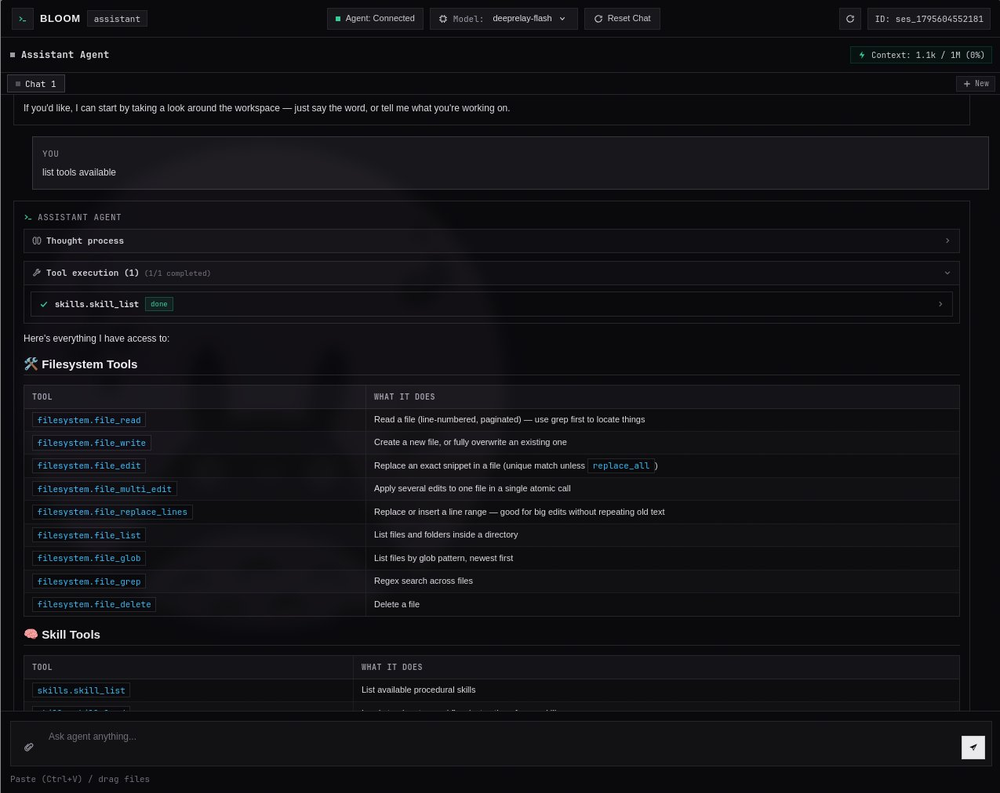

<div align="center">

# Bloom Harness

**A minimal, fail-closed agent harness. One tiny engine. One JSON file defines an entire agent.**

[](pyproject.toml)
[](LICENSE)
[](pyproject.toml)
[](#why-bloom)

</div>

Most agent harnesses are bloated frameworks with sprawling plugins, hidden defaults, and tangled tool wiring. **Bloom flips that:** the core Python runtime is tiny, pure-stdlib at the server layer, and completely immutable across use cases. Change **one JSON file (`agents/<role>.json`)** and you get an entirely different agent—different model, different MCP tools, different approval gates, different procedural skills, and different filesystem boundaries—without touching a line of harness code.



```text
               ┌──────────────────────────────────────────────┐
               │           OpenAI-Compatible LLM              │
               │      (Fixed Prefix KV Cache + 2 Meta-Tools)  │
               └──────────────────────▲───────────────────────┘
                                      │ tool_describe / tool_run
               ┌──────────────────────▼───────────────────────┐
               │             Bloom Core Harness               │
               │  bloom/ (Python CLI + Headless HTTP/SSE API) │
               └──────────────────────┬───────────────────────┘
                                      │ Scoped by agents/<role>.json
        ┌─────────────────────────────┼─────────────────────────────┐
        ▼                             ▼                             ▼
┌───────────────────┐       ┌───────────────────┐       ┌───────────────────┐
│  Pluggable MCP    │       │  Pluggable Skills │       │   Path & Prompt   │
│   servers.json    │       │    skills.json    │       │    Boundaries     │
│ allow / ask / deny│       │     SKILL.md      │       │read_paths / write │
└───────────────────┘       └───────────────────┘       └───────────────────┘
                                      ▲
                                      │ HTTP + SSE (/api/* only)
                            ┌─────────┴─────────┐
                            │   Optional web/   │
                            │   <bloom-chat>    │
                            │  Standalone/Embed │
                            └───────────────────┘
```

---

## Why Bloom?

* **One JSON File = A Completely Different Agent:** Swap `--agent reviewer` for `--agent ops` and Bloom loads a completely different tool surface, MCP servers, `allow`/`ask`/`deny` gates, skill folders, and read/write path jails.
* **No Bloat, No Fallbacks, No Silent Defaults:** Built strictly around `openai`, `rich`, and `prompt-toolkit`. Missing env vars, unresolved `${VAR}` references, invalid manifests, or undeclared tools fail fast with explicit errors instead of guessing.
* **Zero Built-in Domain Tools, Only 2 Meta-Tools (Frozen KV Prefix Cache):** `messages[0]` is deterministic and sorted (`llm.SYSTEM_PROMPT`), transcripts are strictly append-only JSONL, and only **two built-in meta-tools** (`tool_describe`, `tool_run`) are registered with the LLM—all capabilities come from pluggable MCP servers while scaling to 100+ tools with constant schema overhead.
* **Default-Deny Two-Gate Security:**
  1. **Machine Gate (`bloom/servers.json`, `bloom/skills.json`):** Only registered servers and skill roots load at startup; unresolved `${ENV_VAR}` secrets fail closed.
  2. **Agent Gate (`agents/<role>.json`):** Every allowed/confirmed tool must be listed explicitly under `permissions.allow` or `permissions.ask` (no wildcards like `server.*`).
* **Headless API + Optional Zero-Build Web UI (`web/`):** Pure Python `asyncio` HTTP + SSE API server, plus an optional Shadow-DOM `<bloom-chat>` Web Component you can run standalone (`--serve --web`) or drop into any existing web dashboard.

---

## Quickstart

Requires **Linux** and **Python >= 3.10**.

### 1. Install
Using [`uv`](https://docs.astral.sh/uv/) (recommended):
```bash
git clone https://github.com/Rizmi/bloom-harness.git
cd bloom-harness
uv sync
```

Or with `pip`:
```bash
python3 -m venv .venv
source .venv/bin/activate
pip install -e .
```

### 2. Configure `.env` & Models
Copy `.env.example` to `.env` and set your provider API key and workspace directories:
```bash
cp .env.example .env
# Edit .env:
# DEEPRELAY_API_KEY="your-api-key"
# ASSISTANT_READ="workspace/read/"
# ASSISTANT_WRITE="workspace/write/"
# BLOOM_SESSIONS_DIR="sessions/"
# BLOOM_UPLOADS_DIR="uploads/"
```
Edit [`bloom/models.json`](bloom/models.json) to plug in any OpenAI-compatible provider (OpenAI, DeepSeek, OpenRouter, Ollama, vLLM, etc.). Keys use explicit `${ENV_VAR}` expansion.

### 3. Run in Terminal (CLI)
```bash
# Run a named manifest from agents/<name>.json
uv run bloom --agent assistant

# Run an arbitrary local manifest file
uv run bloom --agent ./path/to/custom_agent.json

# Resume the latest session for that agent
uv run bloom --agent assistant --resume
```

### 4. Run Headless API + Default Web UI
```bash
# Pure headless HTTP/SSE API only (for your own UI or automation)
uv run bloom --serve --agent assistant --port 4096

# API + bundled static Web UI at http://127.0.0.1:4096/
uv run bloom --serve --web --agent assistant --port 4096
```

> [!NOTE]
> In `--serve` mode, `--agent` strictly resolves named manifests inside `$BLOOM_AGENTS_DIR` / `agents/` (`resolve_safe`) and pins the server to that single agent (cross-agent requests are rejected with `400`).

---

## One Agent File, Total Control

Drop a JSON file into `agents/<role>.json`. Two agents running on the **exact same Bloom binary** can have zero overlap in capabilities:

### Example A: Read-Only Code & Log Auditor (`agents/auditor.json`)
```json
{
  "model": "deeprelay-flash",
  "system_prompt": "Audit code and logs. Read-only access.",
  "read_paths": ["src/", "tests/", "/var/log/app/"],
  "write_paths": [],
  "skill_paths": ["skills"],
  "skills": ["code-audit"],
  "permissions": {
    "allow": [
      "filesystem.file_read",
      "filesystem.file_grep",
      "filesystem.file_glob",
      "filesystem.file_list",
      "skills.skill_list",
      "skills.skill_load"
    ],
    "ask": []
  }
}
```

### Example B: Workspace Builder with Human Approval (`agents/assistant.json`)
```json
{
  "model": "deeprelay-flash",
  "system_prompt": "Workspace assistant with controlled edits and skills.",
  "read_paths": ["workspace/read/", "workspace/write/"],
  "write_paths": ["workspace/write/"],
  "skill_paths": ["skills"],
  "permissions": {
    "allow": [
      "filesystem.file_read",
      "filesystem.file_write",
      "filesystem.file_edit",
      "filesystem.file_list",
      "skills.skill_list",
      "skills.skill_load"
    ],
    "ask": [
      "filesystem.file_delete"
    ]
  }
}
```

* Tools listed in **`allow`** run autonomously.
* Tools listed in **`ask`** pause execution (`ui.approve()` in CLI, or `permission` SSE + `POST /api/session/{id}/approval` in server mode).
* Everything else is **denied by default**.

---

## Plug-and-Play MCP Servers & Skills

### MCP Servers (`bloom/servers.json`)
Plug in local Python MCP servers, external `stdio` binaries, or remote `streamable_http` endpoints:
```json
{
  "mcpServers": {
    "filesystem": {
      "type": "local",
      "path": "mcp/filesystem/server.py"
    },
    "skills": {
      "type": "local",
      "path": "mcp/skills/server.py"
    },
    "github": {
      "transport": "stdio",
      "command": "npx",
      "args": ["-y", "@modelcontextprotocol/server-github"],
      "env": { "GITHUB_TOKEN": "${GITHUB_TOKEN}" }
    },
    "remote-db": {
      "transport": "streamable_http",
      "url": "https://mcp.example.com/mcp",
      "headers": { "Authorization": "Bearer ${MCP_TOKEN}" }
    }
  }
}
```
Even after a server is registered in `servers.json`, an agent still **cannot see or call any tool** unless that exact `server.tool` name is listed in its `agents/<role>.json` `permissions`.

### Procedural Skills (`bloom/skills.json`)
1. Register trusted skill roots in `bloom/skills.json` (e.g. `["skills"]`).
2. Drop `<skill-name>/SKILL.md` folders into those roots.
3. Scope each agent with `skill_paths` (and optionally an explicit `skills` allowlist) in `agents/<role>.json`.

---

## Embeddable Web UI (`web/`)

`web/` is completely decoupled from `bloom/`—zero template rendering in Python, zero npm/Webpack build step, and zero framework lock-in. It talks exclusively to Bloom's REST + SSE endpoints via [`web/api-client.js`](web/api-client.js).

<p align="center">
  <em>Bundled Shadow-DOM <code>&lt;bloom-chat&gt;</code> UI: collapsible reasoning &amp; tool accordions, live token usage &amp; KV-cache percentage, model switcher, and multi-session tabs.</em>
</p>

```text
web/
├── api-client.js   # Dependency-free BloomApiClient (REST + SSE SDK)
├── bloom-chat.js   # Shadow-DOM <bloom-chat> Web Component
├── index.html      # Standalone page mounting <bloom-chat>
└── lib/            # Bundled offline marked.min.js
```

To embed Bloom chat inside **any** existing web app:
1. Serve `web/` as static files (e.g. `/bloom-web/`).
2. Reverse-proxy `/bloom-api/*` to `http://127.0.0.1:4096/api/*` (injecting `Authorization: Bearer ${BLOOM_API_TOKEN}` server-side behind your own auth).
3. Drop `<bloom-chat>` into HTML:
```html
<script type="module" src="/bloom-web/bloom-chat.js"></script>
<bloom-chat api-base="/bloom-api" title="Workspace Agent" hide-topbar></bloom-chat>
```

---

## Slash Commands (CLI & Web Chat)

* `/help`: Show available commands.
* `/rewind` (or `/rewind <index>` in web): Jump back to a safe earlier checkpoint without breaking `tool_calls` ↔ `tool` pairs.
* `/compact`: Summarize older messages into a KV-cache-preserving `<summary>` in `messages[0]`, keeping recent context untouched.
* `/sessions`: Switch between persisted JSONL sessions.

---

## Environment Variables

* `BLOOM_ROOT`: Root workspace for discovering `agents/`, `mcp/`, and `skills/` (defaults to repo root).
* `BLOOM_SESSIONS_DIR`: Directory for per-agent `sessions/<agent>/` JSONL transcripts (defaults to `sessions/`).
* `BLOOM_AGENTS_DIR` / `BLOOM_AGENTS`: Override directory for `agents/*.json`.
* `BLOOM_MODELS_FILE`, `BLOOM_SERVERS_FILE`, `BLOOM_SKILLS_FILE`: Override JSON config paths.
* `BLOOM_API_TOKEN`: Bearer token required for all `/api/*` HTTP requests (`401` when missing/invalid).
* `BLOOM_CORS_ORIGIN`: CORS origin header (defaults to `*`).
* `BLOOM_UPLOADS_DIR` / `BLOOM_MAX_ATTACH_BYTES`: Upload directory (defaults to `uploads/` in server mode; referenced in `agents/assistant.json` via `${BLOOM_UPLOADS_DIR}`) and size cap (default `25 MB`).
* `BLOOM_MAX_TOOL_ROUNDS`: Max autonomous tool rounds per turn (default `50`).
* `BLOOM_APPROVAL_TIMEOUT`: Seconds an `ask`-tier approval waits over HTTP/SSE (default `300`).
* `COMPACT_WINDOW`, `COMPACT_AT`, `COMPACT_TO`, `RESERVED_OUTPUT`, `COMPACT_MAX_INPUT_TOKENS`: Context budget and compaction tuning (`0.85` trigger, `0.35` keep-tail by default).

---

## Headless HTTP & SSE API Reference

All `/api/*` endpoints return JSON; `POST /api/session/{id}/prompt` streams SSE (`text/event-stream`). Pass `BLOOM_API_TOKEN` in `Authorization: Bearer <token>`.

| Method | Path | Description |
|---|---|---|
| `GET` | `/api/info` | Server status, pinned agent, active model, context limit, agent/model lists |
| `GET` | `/api/agents`, `/api/agents/{name}` | Scoped agent manifest definitions |
| `GET` | `/api/model`, `/api/models` | Model catalog with `api_key` fields redacted |
| `POST` | `/api/model`, `/api/models/switch` | Switch active model `{"model": "..."}` (`409` if busy) |
| `GET` | `/api/tools`, `/api/tools/{name}/describe` | Pinned agent's `allow`/`ask` tools and parameter schemas |
| `GET` | `/api/skills`, `/api/skills/{name}` | Authorized skill list and `SKILL.md` contents |
| `GET` | `/api/mcp` | Connected local & external MCP servers |
| `GET` | `/api/sessions`, `/api/session/active` | Saved sessions for pinned agent & currently running session map |
| `POST` | `/api/session` | Create or open a session `{"id": "..."}` idempotently |
| `GET` / `DELETE` | `/api/session/{id}` | Raw transcript JSON (`GET`) or delete transcript (`DELETE`) |
| `GET` | `/api/session/{id}/message` | Formatted transcript parts + usage (supports optional `?limit=&offset=`) |
| `GET` | `/api/session/{id}/usage` | Token & context metrics (`contextTokens`, `contextLimit`, cached, reasoning) |
| `POST` | `/api/session/{id}/prompt` | **Stream SSE turn** `{"text": "...", "model": "...", "files": [...]}` |
| `POST` | `/api/session/{id}/compact` | Run compaction and return updated `usage` estimate |
| `GET` | `/api/session/{id}/rewind-candidates` | Safe rewind turn indices and previews |
| `POST` | `/api/session/{id}/rewind` | Rewind transcript `{"targetIndex": N}` and return updated `usage` |
| `POST` | `/api/session/{id}/abort` | Abort running turn and clear pending approvals |
| `GET` | `/api/permissions` | Pending `ask`-tier approval requests (optional `?sessionId=`) |
| `POST` | `/api/session/{id}/approval` | Resolve approval `{"requestId": "...", "decision": "approved"\|"rejected"}` |
| `POST` | `/api/attach` | Upload binary file attachment (`X-Filename` header) |
| `GET` | `/`, `/web/*` | *(Only with `--web`)* Static files from `web/` |

### SSE Events (`POST /api/session/{id}/prompt`)
```jsonc
{"type": "start", "sessionId": "...", "agent": "assistant"}
{"type": "thinking"}
{"type": "compacted", "before": 14, "after": 4}
{"type": "delta", "field": "reasoning", "text": "..."}
{"type": "delta", "field": "text", "text": "..."}
{"type": "tool", "callId": "call_1", "tool": "filesystem.file_read", "input": {...}, "output": "...", "state": "completed"}
{"type": "permission", "requestId": "req_123", "sessionId": "...", "tool": "filesystem.file_delete", "arguments": {...}, "action": "...", "resources": [...]}
{"type": "permission_settled", "requestId": "req_123", "sessionId": "...", "approved": true}
{"type": "usage", "promptTokens": 8709, "cachedTokens": 8448, "candidatesTokens": 185, "contextTokens": 8709, "contextLimit": 256000, "contextPercentage": "3.4%"}
{"type": "error", "error": "..."}
{"type": "done", "reason": "stop"}
```

---

## Development & Tests

```bash
uv run python -m unittest tests.test_harness tests.test_server
```

See [`AGENTS.md`](AGENTS.md) for strict architectural invariants and developer rules.
